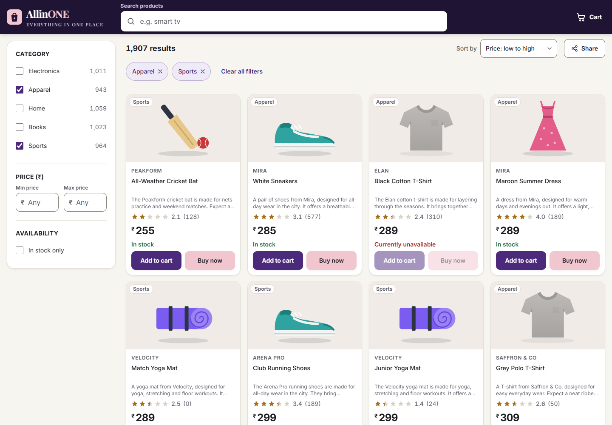
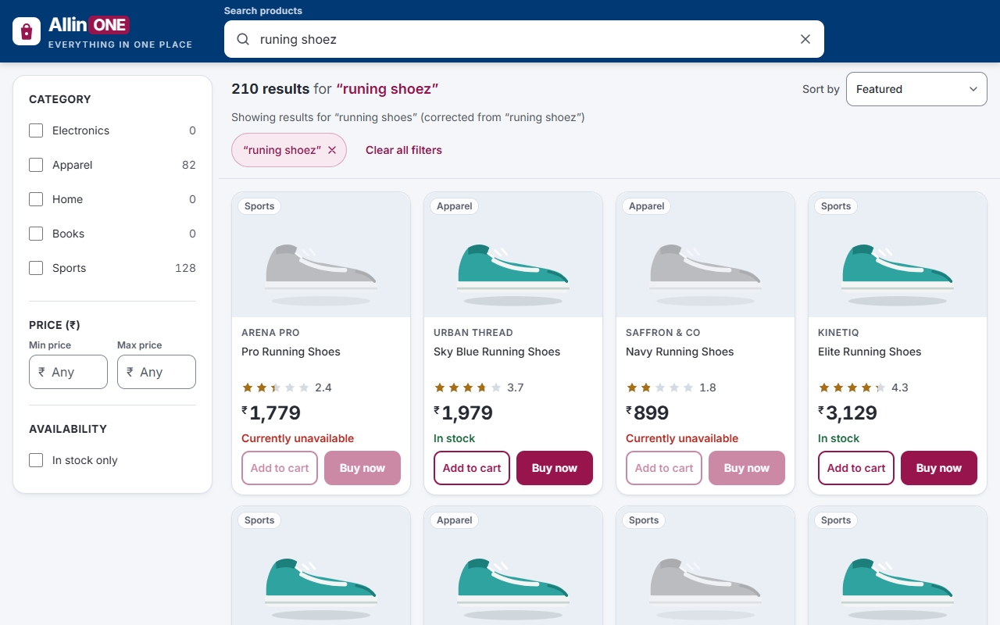
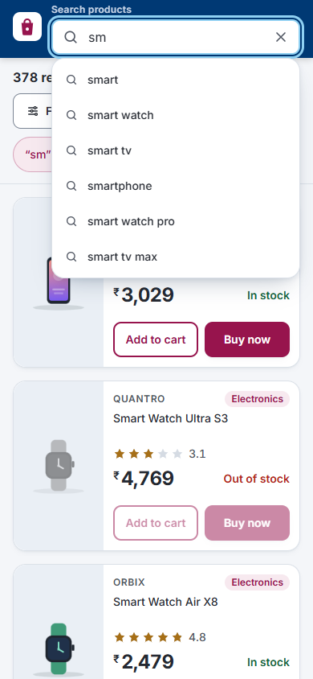
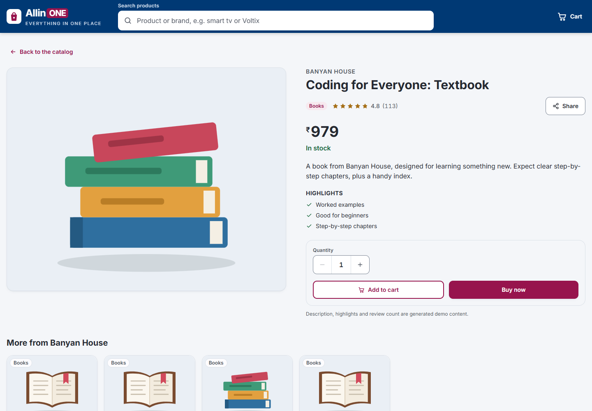
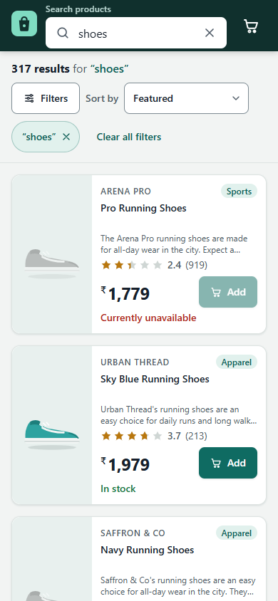

# Product Catalog ("AllinONE" storefront)

A React + TypeScript single-page app that searches, filters and sorts 5,000 products in the
browser, presented as an invented storefront called **AllinONE** in the colours of Axis Max
Life Insurance (MLI). Filter state lives in the URL, every control works from the keyboard, and
the build is a static bundle for S3 + CloudFront.

The default build is **one catalog page**. Each product card shows the eight fields of the
`Product` interface (no extra data) plus Add to cart and Buy now. A product detail page, the
cart page with a demo checkout, and share buttons are built and tested but **off by default**;
see [Configuration](#configuration).

**Live demo:** https://d3t07ggz1uw32y.cloudfront.net (S3 + CloudFront, mock data).



The screenshots show the default build, as on the live demo. Pages behind optional features
are in [`docs/screenshots/optional/`](docs/screenshots/optional).

- [Quick start](#quick-start)
- [Brief requirements and add-ons](#brief-requirements-and-add-ons)
- [Features](#features)
- [UI and design system](#ui-and-design-system)
- [Architecture](#architecture)
- [Performance](#performance)
- [URL contract](#url-contract)
- [Accessibility](#accessibility)
- [Configuration](#configuration)
- [Deploying to S3 + CloudFront](#deploying-to-s3--cloudfront)
- [Tests](#tests)
- [Growth path](#growth-path)
- [What I would improve with more time](#what-i-would-improve-with-more-time)
- [What has and has not been verified](#what-has-and-has-not-been-verified)

## Quick start

Requires Node 22.22+ or 24+ (React Router 8 needs Node 22.22 or later; developed on Node
24.15.0, npm 11.12.1). The e2e, perf and screenshot scripts use the locally installed Google
Chrome; no browser is downloaded.

```bash
npm install
npm run dev        # http://localhost:5173
```

| Script | What it does |
|---|---|
| `npm run dev` | Vite dev server with HMR |
| `npm run build` | Typecheck, then production build into `dist/` |
| `npm run preview` | Serve `dist/` locally (http://localhost:4173) |
| `npm test` | All Vitest suites once (jsdom, React Testing Library) |
| `npm run test:watch` | Vitest in watch mode |
| `npm run typecheck` | `tsc -b` over app, tooling and e2e configs (strict) |
| `npm run lint` | ESLint (typescript-eslint, react-hooks, jsx-a11y, import boundaries) |
| `npm run bench` | Node timings for generate / index / search / sort |
| `npm run e2e` | Playwright end-to-end suite in local Chrome (builds and serves on port 4190) |
| `npm run perf` | Throttled-Chrome measurements at 1x, 4x, 6x CPU (run `npm run build` first) |
| `npm run screenshots` | Regenerates `docs/screenshots/` (run `npm run build` first; builds the optional pages itself) |

To see the error state: open `/?mockFail=1` (the first load fails, Retry recovers), set
`VITE_MOCK_FAIL_RATE=0.3`, or enable the on-page mock controls (see [Configuration](#configuration)).

## Brief requirements and add-ons

### Required by the brief

The mandated stack is used as specified: React 18+ (19.3.1), TypeScript in strict mode
(6.0.3), Vite (8.3.8), `npm run build` to `dist/`, Vitest (5.1.1) + React Testing Library
(16.3.3), `VITE_*` build-time env vars, and S3 + CloudFront static hosting. Tailwind CSS
(4.3.5) is this project's choice for "any styling approach". The `Product` interface is exactly
the brief's eight fields, and the mock API returns exactly that shape.

| Requirement | How it is met | Main files | Tests |
|---|---|---|---|
| React 18+, TypeScript strict, Vite | React 19, `strict` plus `noUncheckedIndexedAccess`, `exactOptionalPropertyTypes`, `noImplicitOverride` | `tsconfig.app.json`, `vite.config.ts` | `npm run typecheck` |
| `npm run build` outputs `dist/` | Typecheck then `vite build`, `base: '/'` | `package.json`, `vite.config.ts` | `npm run build` |
| Deterministic 5,000-product dataset with the given interface | Seeded mulberry32 PRNG, no `Math.random` or dates, frozen objects; item types limited to ones that have an illustration; bell-shaped shop-style prices | `src/domain/product.ts`, `src/data/generateProducts.ts`, `src/data/itemTypes.ts` | `generateProducts.test.ts` (count, ids, categories, ratings, prices, determinism, recorded checksum, price spread, every item type illustrated) |
| Async service, 300–600 ms latency | `MockProductService` with injectable latency, honours `AbortSignal` | `src/data/MockProductService.ts` | `MockProductService.test.ts` |
| Simulated failed (500) response | `ApiError(500)` from a failure policy: `VITE_MOCK_FAIL_RATE`, `?mockFail=N`, `mockControls.failNext(n)` | `src/data/mockControls.ts` | `MockProductService.test.ts`, `CatalogPage.test.tsx`, e2e `states.spec.ts` |
| Instant search by title or brand that never blocks typing | Local input state paints every keystroke; results use `useDeferredValue`; pre-normalised haystacks; stop words, unknown-word and typo fallback (title and brand only, descriptions are not indexed) | `useSearchText.ts`, `src/search/*` | `InMemorySearchEngine.test.ts`, `conversational.test.ts`, `CatalogPage.test.tsx`, e2e `journey.spec.ts` |
| Multi-select category filter | Native checkboxes in a `fieldset`; categories combine with OR | `CategoryFilter.tsx` | engine tests, interaction tests, e2e journey |
| Min / max price | Labelled number inputs, committed on blur or Enter, inclusive, inverted range explained and not applied | `PriceRangeFilter.tsx` | engine tests, interaction tests, e2e journey |
| In-stock filter | Checkbox "In stock only" | `StockToggle.tsx` | engine tests, e2e history |
| Sort: price low-high, high-low, rating highest first | Native select; ties broken by dataset order (stable) | `SortSelect.tsx`, `InMemorySearchEngine.ts` | engine sort tests, e2e journey (prices ascending) |
| Total match count | Heading "N results for “q”" in the results bar; the live region says "N products found" | `ResultSummary.tsx` | interaction and e2e tests |
| "Clear all filters" | Shown in the results bar once a search or filter is applied (and in the empty state). Resets query, filters and sort, keeps foreign URL params, then focuses the results heading | `CatalogPage.tsx`, `ResultSummary.tsx`, `EmptyState.tsx` | interaction tests, e2e journey |
| Filters, query and sort in the URL; reload or shared link restores the view | URL is the only filter store; total parser, canonical serializer | `src/url/*` | `filters-url.test.ts`, e2e `history.spec.ts` (reload, Back/Forward, no history flooding) |
| Loading skeletons | Shimmer skeletons with the exact grid/list card dimensions, `aria-busy` | `LoadingState.tsx` | dimensions shared with the card constants |
| Helpful empty state | Only after a successful load with zero matches; illustration, tips, Clear all | `EmptyState.tsx` | interaction tests, e2e |
| Clean error state with Retry | Status message, Retry focused, `aria-disabled` while retrying, filters kept | `ErrorState.tsx`, `useProducts.ts` | interaction tests, e2e `states.spec.ts` |
| Keyboard navigable (Tab, Enter, Space) | Native controls only; filter checkboxes toggle with Space and with Enter; skip links; drawer focus trap; focus moves to page headings on navigation | `src/components/ui`, features | interaction tests, e2e keyboard-only journey |
| Semantic HTML and label associations | Landmarks, `form role=search`, `fieldset`/`legend`, visible `label` for every field | `src/components/ui/*` | axe in jsdom and in real Chrome |
| aria-live announcement of result count | One app-wide polite region, about 500 ms after results settle; also cart changes and search corrections | `useAnnouncer.ts`, `AppProviders.tsx` | interaction tests, e2e |
| No lag typing or rendering large lists; justified strategy; no redundant re-renders | Row virtualisation, deferred search, memoised cards, cheap per-card cart subscription | `ProductGrid.tsx`, `ProductCard.tsx` | `npm run bench`, `npm run perf`, e2e DOM-count test |
| Client-side routing on S3 + CloudFront with fallback to `/index.html` | CloudFront Function rewrites extension-less paths (any unknown path, e.g. `/ghhghg`, reaches the app and shows Page not found; `/?q=shoes&page=2` reloads in place) | `infra/cloudfront/spa-rewrite.js`, `src/app/router.tsx` | e2e `cloudfront.spec.ts` (runs the function in a VM), e2e deep-link reloads |
| No hardcoded secrets; `VITE_*` config | One module reads `import.meta.env` and validates it | `src/config/env.ts`, `.env.example` | `env.test.ts` |
| Vitest + RTL tests: core filter/sort logic and a user flow | 562 tests in 33 files | `src/**/*.test.ts(x)` | `npm test` |
| README with setup, architecture, performance, CloudFront notes, improvements | This file | `README.md` | n/a |

### Add-ons beyond the brief

Everything in this table is visible in the default build and the live demo.

| Add-on | Why it was added | Where it lives |
|---|---|---|
| Conversational search: stop words, unknown-word and typo fallback | "ek smart tv chahie" and "runing shoez" should find products; the strict match always wins, and any correction is shown above the results | `src/search/stopWords.ts`, `src/search/fuzzy.ts`, `InMemorySearchEngine.ts` |
| Mixed-language aliases (joote, जूते, kitab, किताब, tv/television, earphones...) | Mixed-language shoppers type these terms | `src/search/aliases.ts` |
| Search suggestions and recent searches | From the first letter, completes with phrases and brands from the catalog and offers the last five searches. Typing still filters instantly; nothing is selected unless picked | `src/search/suggest.ts`, `src/search/recentSearches.ts`, `useSearchSuggestions.ts` |
| Search by category name | "elec", "elect" or "electronics" finds the Electronics category (a word of three or more letters that starts a category name); a misspelt name is corrected, and categories appear in the suggestions | `InMemorySearchEngine.ts`, `suggest.ts` |
| Product type filter (sub-categories, `type` in the URL) | Narrow Electronics to LED Monitor or Smart TV, or "shoes" to Running Shoes. `Product` keeps its eight fields: the type is read from the title. Types of the current results are listed with counts once a category or a search narrows the catalog | `src/domain/productType.ts`, `TypeFilter.tsx` |
| Catalog brands in the empty state | The brands are invented, so a real one ("samsung") finds nothing; ten catalog brands (two per category) are offered as one-click searches | `sampleBrands.ts`, `EmptyState.tsx` |
| Pagination (60 per page, `page` in the URL) | A position in 5,000 results is easy to share and return to; rows within a page are still virtualised | `src/domain/pagination.ts`, `components/ui/Pagination.tsx` |
| Add to cart and Buy now on every card | Shopping actions on the catalog. They add to a cart kept in this browser and the card shows "1 in cart"; there is no cart page in the default build, so Buy now says checkout is not part of the demo | `CardActions.tsx`, `src/cart/`; `VITE_FEATURE_BUY_BUTTONS=false` hides them |
| Category facet counts, active filter chips | Quicker refinement and undo | `CategoryFilter.tsx`, `ActiveFilterChips.tsx` |
| Logo as a home link | One click back to all products: clears search, filters and page | `CatalogPage.tsx` |
| MLI colours and the AllinONE identity, bundled font (Inter) | Brand colours as discussed with MLI; self-hosted font, no CDN | Tokens in `src/index.css`, `Wordmark.tsx` |
| 29 bundled product illustrations | Every item type shows a picture of that kind of item | `src/assets/thumbnails/`, `src/data/thumbnails.ts` |
| Link-preview tags and image (`VITE_SITE_URL`) | A shared link shows a card with the site name in chat apps | Tags in `index.html`, `public/og-image.png`, `siteUrl` plugin in `vite.config.ts` |
| React Router | URL state with Back/Forward history, and the 404 page | `src/url/useFilterState.ts`, `src/app/*` |
| TanStack Virtual | A few dozen cards in the DOM at any time | `ProductGrid.tsx` |

### Built but switched off by default

These are in the code and covered by tests (72 of the real-Chrome tests run on a build with
them switched on), but the default build and the live demo leave them out, so the app is the
single catalog page the brief describes. **None of them appears in the UI unless its
build-time variable is set**; a path such as `/cart` or `/product/p-00001` shows "Page not
found". The code stays because each is a likely next step, and one variable brings it back.

| Feature | Turn on with | What then appears |
|---|---|---|
| Product detail page | `VITE_FEATURE_PRODUCT_PAGE=true` | Card titles link to `/product/:id`: large illustration, generated description and highlights, quantity, related products |
| Cart page and demo checkout | `VITE_FEATURE_CART=true` | Header cart link with count, `/cart` (change quantity, remove, totals in INR, shared cart links) and `/checkout` (validated delivery form; no payment, nothing stored or sent); Buy now opens checkout |
| Share button | `VITE_FEATURE_SHARE=true` | Copy link, WhatsApp, email and Teams on the catalog, product page and cart. Without it, the address bar is the share mechanism, as the brief asks |
| Smart search | `VITE_FEATURE_SMART_SEARCH=true` | "shoes under 5000 in stock" offered as filters |
| Simulate API failure button | `VITE_ENABLE_MOCK_CONTROLS=true` | A button that makes the next load fail. `?mockFail=1` in the URL does the same on any build |
| Real API | `VITE_API_BASE_URL=https://...` | Products from `${VITE_API_BASE_URL}/products` (`HttpProductService`, with timeout and retries) instead of the mock |
| Per-product link previews | `npm run build:previews` after the build | One HTML file per product, so a shared product link shows its name and price; only useful with the product page on |

### Developer tooling (not part of the app)

| Tool | Purpose |
|---|---|
| Playwright e2e suite | Real Chrome checks that jsdom cannot do: layout, scrolling, Back/Forward, focus rings, contrast via axe. Builds both the default and the all-features version. Not in CI (Chrome on CI runners not verified from here) |
| vitest-axe, axe-core | Accessibility scans in jsdom and in real Chrome |
| ESLint with import-boundary rules | Hook mistakes, a11y regressions, layer dependencies (`eslint.config.js`) |
| Perf, screenshot and bench scripts | Throttled-Chrome numbers, reproducible screenshots, Node timings (`scripts/`) |
| `infra/cloudfront/`, CI workflow | The CloudFront function and deploy script; checks on push |

## Features

### Catalog search

Search runs on title and brand only, as the brief specifies (descriptions are not indexed).
For a query the engine does, in order:

1. **Stop words.** Conversational filler in English and Hindi-English, Latin and Devanagari
   (a, the, please, show, ek, mujhe, chahiye/chahie/chaiye, dikhao, wala, एक, मुझे, चाहिए, ...)
   is removed. A query made only of stop words is kept as ordinary words, so "the" searches
   for "the" instead of silently returning 5,000 products.
2. **Strict match.** Every remaining word (or one of its aliases) must appear. If anything
   matches, that is the result and nothing else runs.
3. **Run-together words.** A word that matches no product at all is split when it is two
   catalog words joined: "smarttv" becomes "smart tv", "yogamat" becomes "yoga mat".
4. **Typo correction.** Otherwise it is replaced by the closest catalog word (titles, brands
   and alias keys, built once with the index): Damerau-Levenshtein distance 1 for 4 letters,
   2 for 5–8, 3 for 9 or more, none for shorter words; ties go to the word in more products,
   then alphabetical. "shooz" finds shoes.
5. **Sounds alike.** If nothing is that close, a rough phonetic key (ph→f, soft c→s, z→s,
   vowels after the first letter dropped, repeats collapsed) is compared, so "hedfones" finds
   headphones. Latin script only; keys under three letters never match.
6. **Unknown words.** Words with no match by any of these are dropped and the search runs again.

When steps 3–6 change the result, a note appears above the results and in the live region,
for example `Showing results for “running shoes” (corrected from “runing shoez”)` or
`Showing results for “smart tv” — ignored: “xyzabc”`. The URL and the search box keep exactly
what was typed; the relaxation is derived, and the result object carries the corrections so
the UI does not recompute them. If no word matches anything, the normal empty state shows.



### Search suggestions

As text is typed, the search box lists up to six completions, and results still update on
every keystroke exactly as before: a suggestion is only applied when it is picked.

- **Where they come from.** Every run of one to three consecutive title words shared by at
  least two products, plus every brand, counted once per catalog load. Because the phrases
  come from the titles, every suggestion finds products. Product types rise to the top by
  count ("sma" gives smart watch, smart tv, smartphone before any single model), and a
  fragment that only ever occurs inside one longer phrase is dropped ("yoga" in favour of
  "yoga mat"). Suggestions start from the first typed letter.
- **Recent searches.** The last five searches confirmed with Enter or by picking a suggestion
  are kept in this browser's storage and offered when the box is empty or they match what is
  typed. Nothing is sent anywhere; unreadable stored data is ignored.
- **Keyboard and screen readers.** The field is a combobox with a listbox (WAI-ARIA list
  autocomplete, manual selection): Down and Up move the highlight, Enter picks it, Esc closes
  the list and keeps the text, Tab moves on without picking. Focus never leaves the field.
- The same suggestions appear in the header search on the product, cart and checkout pages,
  where picking one opens the catalog with that query.



### Add to cart and Buy now

Every card has Add to cart (burgundy outline) and Buy now (solid burgundy). They add the
product to a cart kept in this browser's storage, announce it ("Added Olive Running Shoes to
cart") and show "1 in cart" on the card. The default build has no cart page, so Buy now adds
the product and announces that checkout is not part of the demo, without leaving the page.
For unavailable products both buttons are disabled, with the reason in text ("Currently
unavailable", linked with `aria-describedby`).

### Product page, cart and checkout (off by default)

Not in the default build or the live demo; see
[Built but switched off by default](#built-but-switched-off-by-default). With
`VITE_FEATURE_PRODUCT_PAGE=true` and `VITE_FEATURE_CART=true`:

- **Product page** `/product/:id` (lazy-loaded): large illustration, brand, title, category,
  star rating with review count, price, stock, generated description and highlights, quantity
  stepper, Add to cart, Buy now, and two related strips computed from the dataset. Unknown ids
  show "Product not found" with a link back. The card's title is a real router link and its
  overlay makes the whole card clickable; the card actions sit above it.
- **Back to results** returns to the same filtered view (the URL) at the same scroll position
  (saved per history entry and restored once the virtual list has its height), with focus on
  the product link that was opened. The browser's own scroll restoration is switched off
  because it runs before the list exists.
- **Cart** (`CartStore` interface, localStorage implementation, memory implementation in
  tests): add, change quantity (1–10), remove, clear, line totals and grand total in INR,
  count badge in the header, cross-tab sync via the `storage` event. Only ids and quantities
  are stored; prices always come from the dataset. Corrupt JSON, bad quantities, unknown or
  unavailable ids read from storage are dropped, never a crash. Changes are announced
  ("Added Olive Running Shoes to cart"). Cart state is not in the URL.
- **Buy now** adds one (if not already in the cart) and opens `/checkout`.
- **Demo checkout**: order summary and a delivery form (name, address, PIN code, mobile) with
  native inputs, visible labels, inline validation, messages tied with `aria-describedby`,
  and focus on the first invalid field. A visible notice says this is a demo store: **no
  payment is taken, nothing is shipped, and the details are not sent anywhere or stored**.
  That is true in code: the values live only in component state and are cleared when the
  order is placed; the e2e test checks localStorage and sessionStorage afterwards. Placing the
  order clears the cart and shows a confirmation with a random reference. An empty cart on
  `/checkout` goes to the cart's empty state.
- **Phone list cards** carry both buttons too, on their own row under the price; the stock
  line sits beside the price with the short label "Out of stock". Checked at 390, 360 and
  320 px: content fits the fixed card height and nothing scrolls sideways.

### Sharing a view

The brief asks that sharing the URL restores the exact filtered view. That is met by the URL
itself: the address bar always holds the full filter state, so copying it is enough.

Off by default (`VITE_FEATURE_SHARE=true` turns it on), a **Share** button in the results bar
makes that explicit: on touch devices it opens
the system share sheet, elsewhere it copies the link and confirms with "Copied" and a
live-region message. It reads the address bar when pressed, so it shares exactly what a
reload would restore. The share sheet and clipboard APIs need HTTPS; on plain HTTP a legacy
copy is tried, and if that fails the message says to copy from the address bar.

With `VITE_FEATURE_PRODUCT_PAGE=true`, the product page (not in the default build):



### Generated display content (product page only, off by default)

Descriptions, highlights and review counts are **generated mock content**, not part of the
brief's data. `Product` stays exactly the eight fields and the mock API returns exactly that.
`src/data/productContent.ts` derives the content deterministically from a product: its id
seeds a private PRNG (separate from the dataset's stream, so the dataset and its checksum are
unaffected), and templates are chosen by item kind so the wording fits (no "comfortable fit"
on a speaker), with verb agreement for plural items ("running shoes are"). Review counts are
spread log-uniformly, loosely higher for mid-priced items, with a few at zero. A real API
would return these fields itself, and a different `ProductContentProvider` would pass them
through. The product page labels them as generated demo content.

### Dataset

- **Illustrations**: 29 SVGs (0.47–0.92 kB each). Every item type the generator can produce
  maps to an illustration of that kind of item (a TV shows a screen, a helmet a helmet). The
  mapping is a total `Record<ItemType, ...>`, so a missing one fails to compile, and a test
  checks every item type and that no illustration is unused. Item-type pools were narrowed to
  types worth drawing.
- **Prices**: drawn bell-shaped in log space (mean of three uniforms) and rounded shop-style
  (ending in 5 or 9 below ₹1,000, in 9 above, in 99 above ₹10,000). The earlier log-uniform
  draw piled products onto each category minimum (eight or more cards at ₹199 when sorting
  low to high). Now the most common price is shared by 22 products (the test allows at most
  25) and the 16 cheapest products have at most four at one price. This changed the dataset;
  the recorded checksum was updated deliberately.

## UI and design system

The UI follows shopping-site conventions (strong search bar, dense grid, filter sidebar,
results bar, chips) with the store name **AllinONE** and a shopping-bag mark, coloured after
**Axis Max Life Insurance (MLI)**: burgundy `#97144d` and navy `#003974` are the two fills of
the official MLI logo file (`axismaxlife.com/static-page/assets/homepage/axis-max-life-insurance-logo.svg`),
and `#505662` / `#252931` are the body and badge text colours on axismaxlife.com. Navy carries
the header and footer, burgundy the actions, links, chips and the "ONE" tab of the wordmark;
lighter tints are derived from the two. The MLI logo itself is not used: an official logo file
should come from MLI with permission to show it, and would replace the bag mark in
`Wordmark.tsx`.

Type is one sans-serif family, as on the MLI site: Inter, bundled with the app
(`@fontsource-variable/inter`, about 48 KB for Latin), with Noto Sans (the MLI site's face) next
in the font stack where it is installed. Nothing is fetched from a CDN.

| Area | What it looks like |
|---|---|
| Header | Sticky navy bar: wordmark (bag mark only on phones; on the catalog it is a link that clears search, filters and page and returns to the top), visible "Search products" label, search field with icon and Clear button (cart link with count badge when the cart is on). One compact row on phones (72 px). |
| Results bar | "N results for “q”", Filters button (below 1024 px), Sort select, relaxation note, and (once anything is applied) chips and Clear all. Sticky under the header from 768 px up; on phones it scrolls away so the pinned area stays at 72 px. |
| Filter sidebar | Card with Category, Price and Availability sections and right-aligned facet counts; stays in view. Below 1024 px the same panel opens in a drawer with a sticky "Show N results" button. |
| Product card | The eight `Product` fields: illustration (`thumbnailUrl`) with category badge, brand, two-line title, star rating with its value, price with a raised ₹, stock line ("1 in cart" after adding). Then Add to cart (burgundy outline) and Buy now (solid burgundy). Without the cart page, Buy now adds the product and announces that checkout is not part of the demo. With the product page on, the title is a link (with hover cues on pointer devices). Fixed height: 24.125 rem in the grid and 13.25 rem in the phone list layout (21 and 9.375 rem with `VITE_FEATURE_BUY_BUTTONS=false`), so the last line sits on the bottom padding (checked in Chrome at 1440, 768, 390 and 320 px). All text clamps. |
| Pages | One catalog page by default. With the optional features on, the product page, cart, checkout, confirmation and 404 share one layout with a header search that opens the catalog. |
| States | Shimmer skeletons matching both card layouts; error state with Retry; empty state with Clear all and, after a search, up to ten catalog brands (two per category) to search instead, since the brands are invented and a real one such as "samsung" finds nothing. |
| Pagination | "Showing 61–120 of 317", then Previous, numbered pages and Next; phones get "Page 3 of 6" between the arrows. |



Screenshots in [`docs/screenshots/`](docs/screenshots) (headless Chrome against the production
build, regenerated with `npm run screenshots`): catalog at 1440, 768 and 390 px, typo
correction, search suggestions, pagination, empty, error, phone filter drawer, 404, and
`focus/` with the focus ring on the search field (navy header), the Clear button inside the
field, a checkbox, the sort select, a ghost button, Add to cart, Buy now and Retry (light
surfaces). `optional/` holds the product page at 1440 and 390 px, cart, checkout with
validation errors and confirmation, captured from a second build with those features on.

### Design tokens

Defined once in `src/index.css` (Tailwind v4 `@theme`). The default Tailwind palette is
switched off (`--color-*: initial`), so only token colours exist.

| Group | Tokens |
|---|---|
| Text | `ink` #252931, `ink-muted` #505662 (both from axismaxlife.com) |
| Surfaces and lines | `surface` #f4f6f9, `card` #ffffff, `tint` #eaeff5, `line` #dbe1e8, `line-strong` #7b8594 |
| Brand (MLI) | `brand` #97144d (logo burgundy), `brand-strong` #7a1040, `brand-soft` #f7e9ef, `brand-ink` #97144d, `header` #003974 (logo navy), `header-muted` #c9d6e8, `accent` #8fd0f2, `accent-strong` #6cbfeb |
| Status | `success` #17663a, `danger` #b3261e, `danger-soft` #fbeceb, `warn-soft` / `warn-ink`, `star` #a66f17, `star-empty` #d5dbe3 |
| Interaction | `focus` #1f5fd1 (ring on light surfaces; `accent` on the navy header and footer), `overlay`, `skeleton`, `skeleton-shine` |
| Shape, depth, type | `radius-control`, `radius-card`, `shadow-card`, `shadow-hover`, `shadow-raised`, `shadow-header`, `font-sans`, `font-display`, `animate-shimmer` |

Contrast, computed from the hex values (and checked on rendered pages by axe in real Chrome,
which found no violations):

| Pair | Ratio |
|---|---:|
| `ink` on `card` / `surface` | 14.58 / 13.47 |
| `ink-muted` on `card` / `surface` / `tint` / `brand-soft` | 7.37 / 6.81 / 6.38 / 6.27 |
| white on `brand` (primary button, "ONE" tab) / `brand-strong` (hover) | 8.32 / 10.63 |
| `brand-ink` on `card` / `surface` / `brand-soft` / `tint` | 8.32 / 7.69 / 7.08 / 7.20 |
| white / `header-muted` on `header` | 11.43 / 7.76 |
| `success` on `card`; `danger` on `card` / `danger-soft` | 7.00; 6.54 / 5.70 |
| `warn-ink` on `warn-soft` | 7.31 |
| Focus ring `focus` on `card` / `surface`; `accent` on `header` (non-text, 3:1 needed) | 5.81 / 5.36 / 6.79 |
| Input border on `card`, filled star on `card` / `tint` (non-text) | 3.73, 4.28 / 3.70 |

Burgundy on navy is 1.37:1, so burgundy is never used as text or a line on the header: the
"ONE" of the wordmark is white on a burgundy tab.

### Primitives

`src/components/ui`: `Button` (primary, accent, secondary, ghost; `buttonClassName` for links),
`IconButton`, `Card`, `Badge`, `StarRating` (single SVG, fill to the decimal, review count,
"Rated 4.3 out of 5 from 1,284 reviews" for screen readers), `QuantityStepper`, `TextField`,
`TextAreaField`, `Checkbox`, `Select`, `Skeleton`, `Drawer`, `LiveRegion`, `VisuallyHidden`,
inline `icons`. `src/components/layout`: `SiteHeader`, `Wordmark`, `SiteFooter`.

## Architecture

```
src/
  domain/        Product, Category, FilterState, SortKey
  data/          PRNG, item types, generator, illustrations, ProductService (mock/HTTP),
                 mock controls, generated product content
  search/        normalize, aliases, stop words, fuzzy matching, index, SearchEngine
  smart-search/  QueryInterpreter + rule-based implementation (add-on)
  cart/          CartStore (framework-free), storage backends, cart summary (add-on)
  url/           parseFilters / serializeFilters (pure), useFilterState
  config/        env.ts: the only reader of import.meta.env
  hooks/         useServices, useCatalogData, useProducts, useCart, useCartQuantity, useAnnounce,
                 useScrollMemory, usePageMeta, useDebouncedCallback, useContainerWidth
  components/    ui/ primitives, layout/ header, wordmark, footer
  features/      catalog/, product/, cart/ (cart, checkout, confirmation), shell/, not-found/,
                 shared/ (pieces several features use: ErrorState, Price, ShareButton, format)
  app/           App, AppProviders, ServicesProvider, router (lazy routes), ErrorBoundary
```

Dependency direction is `domain` ← `data`, `search`, `smart-search`, `cart`, `url` ← `hooks` ←
`features` ← `app`, enforced by `no-restricted-imports` in `eslint.config.js`. Framework-free
layers cannot import React; `components/ui` cannot import anything product-specific, and `features/shared` cannot import
from any single feature.

**Interfaces, injected.** The UI depends on `ProductService`, `SearchEngine`,
`QueryInterpreter`, `CartStore` and `ProductContentProvider`. `app/ServicesProvider.tsx` picks
implementations; tests pass fakes (memory cart, zero-latency service) through the same context.

**State.** The URL is the only store for filter state. The catalog is loaded once for the whole
app (`AppProviders`), so moving between pages never refetches and Back renders immediately.
Cart state lives in `CartStore` (read with `useSyncExternalStore`). Everything else is local:
search text, price drafts, the drawer flag, the checkout form.

**Data flow on a keystroke.** The input updates local text (urgent render); `useDeferredValue`
feeds the search in an interruptible render; after 250 ms idle `q` is written to the URL with
`replace`, so typing does not flood history. Discrete changes (checkboxes, sort, chips, clear)
use `push`.

## Performance

### Rendering strategy

- **Pages of 60, then virtualised rows.** Results are shown 60 at a time with Previous,
  numbered pages and Next below the list (phones: "Page 3 of 6" between the arrows). 60 is a
  whole number of rows at every column count (1 to 6). The page is in the URL (`page=3`), so a
  shared link or a reload opens the same page, Back returns to the previous one, and any filter
  change starts again at page 1. Pages make a position in 5,000 results easy to share and to
  return to; within a page, `useWindowVirtualizer` still renders only the rows near the screen
  (column count from the container width; fixed card heights, so offsets are computed). While
  scrolling a whole page, the e2e suite saw at most 28 cards in the DOM at 1440 px and 8 at 390 px.
- **Rows are contained.** Each row has `contain: strict` (with 6 px of padding so focus rings
  are not clipped). Rendering is batched into frames (`useFlushSync: false`). The row holding
  keyboard focus is kept mounted by a custom range extractor.
- **Cheap cards.** `React.memo` with stable frozen products; a per-card cart subscription that
  reads one number (`useCartQuantity`); the star rating is one small SVG.
- **Search stays on the main thread.** Filtering is sub-millisecond in Node and a few ms at
  6x throttle; the measured cost is rendering, which a Worker would not remove. The engine sits
  behind `SearchEngine`, so a Worker can replace it if the catalog grows a lot.

### Node bench

`npm run bench` (real modules through Vite; median / p95 ms). Machine: Intel Core i7-1355U,
12 logical cores, 32 GB RAM, Windows 11, Node v24.15.0. **These figures were taken while the
machine was under other load** (a dev server and desktop apps using 1.5+ cores); earlier
quiet runs were roughly a third faster.

| Case | Median | p95 | Matches |
|---|---:|---:|---:|
| `generateProducts(5,000)` | 2.863 | 5.458 | |
| `buildIndex(5,000)` (with vocabulary) | 4.596 | 8.216 | |
| no filters | 0.036 | 0.078 | 5,000 |
| `q="shoes"` | 0.322 | 0.448 | 317 |
| `q="running shoes"` | 0.337 | 0.467 | 210 |
| `q="joote"` (alias) | 1.356 | 1.413 | 396 |
| `q="ek smart tv chahie"` (stop words) | 0.341 | 0.376 | 131 |
| `q="smart tv xyzabc"` (unknown-word fallback) | 1.460 | 2.266 | 131 |
| `q="runing shoez"` (typo correction) | 2.675 | 3.694 | 210 |
| worst case: two long unknown words | 2.032 | 2.927 | 0 |
| sort by price, all 5,000 | 1.160 | 1.266 | 5,000 |
| the brief's example URL | 0.320 | 0.447 | 260 |
| typing "runing shoez", 12 searches (total) | 14.804 | 22.332 | |
| typing "running shoes", 13 searches (total) | 5.416 | 7.608 | |

The stop-word step costs nothing measurable. The fallback and fuzzy path only run when the
strict match is empty; then a search costs about 1.5–2.7 ms here instead of about 0.3 ms
(roughly 1.2 ms per keystroke while typing a misspelt query versus 0.4 ms).

### Throttled Chrome (`npm run perf`)

Headless Chrome 157, 390×844 phone viewport with touch emulation, CPU throttled via CDP.
Typing at about 8 keys/s (keydown to next painted frame) and scrolling with wheel steps at
about 3,000 px/s for 6 s. An idle baseline is recorded first; it showed no late frames, so
the browser itself was producing frames normally. Results in `docs/perf-results.json`. This
run is of the current build (bundled fonts, Share button, card hover, phone filter sheet
included). A dev server and a preview server were running but idle on the same machine.
**It is throttled desktop Chrome, not a phone: no real phone has been measured.**

| CPU | Typing: keystroke to frame (median / p95 / max) | Typing long tasks | Scroll: frame interval (median / p95) | Late frames (> 25 ms) | Scroll long tasks | Main thread during scroll |
|---|---|---:|---|---:|---:|---|
| 1x | 5.3 / 19.7 / 22.7 ms | 0 | 16.7 / 16.7 ms | 0 of 715 | 0 | mostly idle |
| 4x | 26.6 / 60.2 / 66.3 ms | 6 | 16.7 / 16.7 ms (max 17.3) | 0 of 743 | 0 | 37% browser-native, 7% app JS |
| 6x | 44.6 / 100.8 / 111.7 ms | 12 | 16.7 / 49.9 ms (max 99.9) | 125 of 785 (16%) | 2 (65 ms) | 57% browser-native, 10% app JS |

Reading: smooth at 1x and at 4x (no late scroll frames). At 6x, typing stays well inside a
200 ms responsiveness target (p95 about 101 ms), and **about one scroll frame in six is late,
with two long tasks**. A second 6x run gave typing p95 108.6 ms and 112 of 763 frames late
(15%), so the result is repeatable. The profile shows the remaining scroll cost is mostly the
browser's own style, layout and paint work for newly mounted cards, not app JavaScript.

These numbers are sensitive to what else the machine is doing: a run taken while it was busy
with other work read much worse at 6x, so compare runs only under similar conditions.

What keeps scrolling cheap, each found by profiling under throttling:

- Virtual rows use `contain: strict`, with 6 px of padding so a focus ring still fits inside
  the row. In an A/B test this was the largest single win (about 19 late frames per 100,
  against about 75 without paint containment).
- The virtualizer renders once per frame rather than synchronously inside every scroll event.
- Each card subscribes to one number from the cart (its own quantity) and runs no effects.
- The star rating is a single small SVG.
- Scroll-position saves are debounced.
- The card's focus ring is drawn on the link overlay rather than with a per-card `:has()`
  selector.
- The results bar has no backdrop blur.
- Two rows of overscan.

## URL contract

| Param | Example | Meaning | Default (omitted) |
|---|---|---|---|
| `q` | `q=running%20shoes` | Text query exactly as typed (trimmed, max 100 characters) | empty |
| `category` | `category=Apparel,Sports` | Comma-separated, canonical order | all |
| `type` | `type=Smart%20TV,LED%20Monitor` | Product types, comma-separated, canonical order; unknown names are dropped. Unticking a category removes the types that belonged only to it | all |
| `minPrice` / `maxPrice` | `maxPrice=5000` | Inclusive bounds (INR) | none |
| `inStock` | `inStock=true` | Only in-stock products | all |
| `sort` | `sort=price_asc` | `price_asc`, `price_desc`, `rating_desc` | dataset order ("Featured") |
| `page` | `page=3` | Result page (60 per page). A page past the end shows the last page; anything but a whole number from 1 to 10,000 is page 1. Reset to 1 when a filter changes | 1 |

Parsing never throws; one view has one canonical URL (rewritten once with `replace` if not);
foreign params (`mockFail`, `utm_*`) are preserved. Stop-word removal, corrections and ignored
words are derived from `q`, never written back. Cart state is not in the URL. Other routes:
`/product/:id`, `/cart`, `/checkout`, `/checkout/confirmation` (shown once after an order).

## Errors and resilience

The aim is that a user rarely sees an error, and that when one is unavoidable it names its
cause and offers the next step.

**Preventing errors**

- With the bundled mock dataset there is no request that can fail: data is generated in the
  browser. The only failure is the simulated one the brief asks for.
- With a real API (`VITE_API_BASE_URL`), `RetryingProductService` wraps the HTTP service and
  quietly retries short-lived failures (network drop, timeout, 429, 500, 502, 503, 504) twice
  with exponential backoff and jitter (about 0.4 s, then 0.8 s). Failures that retrying cannot
  fix (404, 401/403, other 4xx, an unreadable body) and being offline are not retried. The
  mock is deliberately not wrapped, so its simulated failure reaches the screen.
- Requests time out after 10 s instead of hanging; an aborted request is never shown as an
  error.
- Every external input is parsed by a function that cannot throw: the URL, a shared cart
  link, values in browser storage, and the API response (shape-checked product by product).
- After a deploy, a tab opened before it would ask for a code-split chunk that no longer
  exists; that failure triggers one automatic reload, never a loop.

**When an error does happen**

| Situation | What the user sees | Recovery |
|---|---|---|
| Offline | "You appear to be offline…" | Retries by itself when the browser is back online; Retry button |
| No response while online (DNS, CORS, reset) | "The request did not complete. Check your connection." | Retry |
| Timeout, or HTTP 408 | "The server took too long to answer…" | Retry |
| 429 | "Too many requests…wait a few seconds" | Retry |
| 502 / 503 / 504 | "Temporarily unavailable (status N)…usually clears up within a minute" | Retry |
| Other 5xx (the simulated 500) | "The server responded with an error (status N)." | Retry |
| 404, 401 / 403, other 4xx | Names the status and says retrying is unlikely to help | Retry stays available |
| 2xx with a body that is not JSON or not products | "…data this page could not read" | Retry stays available |
| Unknown URL path | Not-found page with a way back to the catalog | Link |
| Unknown product id | "Product not found" with a link back | Link |
| Shared cart link with unknown or malformed items | Notice that nothing is available; the visitor's own cart is untouched | Dismiss |
| Product image fails to load | Fallback tile with the category initial; layout does not move | none needed |
| Browser storage blocked or full | Cart works for the page's lifetime; nothing crashes | none needed |
| A render error | "Something went wrong" with a Reload button (error boundary) | Reload |

Search text, filters and sort are kept across every one of these: they live in the URL.

Each message can be seen without a real server: `/?mockFail=1&mockStatus=503` (or `404`,
`403`, `429`, `500`, `502`, `504`, `408`, `network`, `timeout`). `mockFail=N` fails the first
N requests of the page load.

At the hosting level (see [Deploying](#deploying-to-s3--cloudfront)): a missing hashed asset
stays a real 404 rather than an HTML page, and unknown paths without a file extension are
rewritten to `/index.html` so the app can show its own not-found page.

Not done: the retry and timeout paths have unit tests with a fake `fetch` but have not been
run against a live API; there is no error-reporting service, and no offline cache of a
previously loaded catalog.

## Accessibility

- Native controls with visible labels everywhere; `fieldset`/`legend` for filter groups;
  skip links on every page.
- Tab, Enter and Space, as the brief lists: buttons, chips and Clear all take Enter and Space;
  the sort select opens with either; price fields commit on Enter. A native checkbox toggles
  only on Space, so the filter checkboxes also toggle on Enter (`Checkbox.tsx`).
- One polite live region for results, loading, errors, cart changes and search corrections.
- Focus: Clear all and chip removal → results heading; the suggestion list opens only on the
  user's own click, typing or Down in the search field, never because focus moved there; Retry focused on error and
  results heading after recovery; drawer traps focus, Esc closes, focus returns; after
  navigation focus moves to the page heading; Back to the catalog refocuses the opened
  product link; checkout submit focuses the first invalid field.
- Product list is `role="list"` with `aria-posinset`/`aria-setsize`; the focused row stays
  mounted while scrolling (tested in real Chrome).
- Ratings, prices and the cart badge have one plain screen-reader text each ("Rated 4.3 out
  of 5 from 1,284 reviews", "₹1,249", "Cart, 2 items"); decorative icons are `aria-hidden`;
  stock is stated in text.
- Focus ring 3 px, blue on light surfaces and light blue on the navy header, never animated
  (components transition colour, background and border only); 44 px touch targets; motion only
  without `prefers-reduced-motion`.
- axe-core in real Chrome found no violations on: catalog, filtered catalog, phone list, empty,
  error, drawer, 404, product page (desktop and phone), unavailable product, empty cart, filled
  cart, checkout with errors and confirmation. It found and I fixed one issue on the way: the
  header cart link's name did not contain its visible text.

## Configuration

`VITE_*` variables are read at build time in `src/config/env.ts` (see `.env.example`) and are
public; there are no secrets. `VITE_API_BASE_URL` (real API), `VITE_MOCK_FAIL_RATE`,
`VITE_ENABLE_MOCK_CONTROLS`, `VITE_FEATURE_SMART_SEARCH`. `?mockFail=N` fails the first N loads.

| Feature flag | Default | On means |
|---|---|---|
| `VITE_FEATURE_PRODUCT_PAGE` | off | Card titles link to `/product/:id` (details, related products) |
| `VITE_FEATURE_CART` | off | Add to cart and Buy now on cards and the product page, header cart link, `/cart`, `/checkout` |
| `VITE_FEATURE_SHARE` | off | Share buttons on the catalog, product page and cart (copy link, WhatsApp, email, Teams) |
| `VITE_FEATURE_SMART_SEARCH` | off | "Shoes under 5000 in stock" offered as filters |
| `VITE_FEATURE_BUY_BUTTONS` | **on** | Add to cart and Buy now on every card (`false` hides them) |
| `VITE_ENABLE_MOCK_CONTROLS` | off | A "Simulate API failure" button under the results bar: the next load fails with a simulated 500, the error state shows, Retry recovers |

On any build, `?mockFail=1` in the URL does the same without a button: the first load fails
with a simulated 500 and the error state offers Retry (`?mockFail=2` fails two loads).

Flags reach the UI through `Services.features` (`useFeatures()`), so a component never reads
the environment, and tests choose features per render. A feature that is off is not rendered at
all; its code stays in the repository and in lazy chunks that are never loaded.

## Deploying to S3 + CloudFront

The demo at https://d3t07ggz1uw32y.cloudfront.net is deployed this way.

1. `npm ci && npm run build` with any `VITE_*` variables set. `VITE_SITE_URL` is the public
   address (link-preview images must be absolute URLs).
2. Optional: `npm run build:previews` writes `dist/product/<id>.html` for every product, the
   same app shell with that product's name, price, rating and stock in its preview tags.
   Preview fetchers (WhatsApp, Teams, email) do not run JavaScript, so without this step
   every link shows the site-level card.
3. Private S3 bucket, all public access blocked, read only by the distribution through Origin
   Access Control. The bucket policy also allows `s3:ListBucket` to the distribution, so a
   missing file is a 404 and not a 403.
4. Attach `infra/cloudfront/spa-rewrite.js` as a viewer-request CloudFront Function:
   - `/product/p-00042` is served from `/product/p-00042.html`; ids outside the catalog go to
     `/index.html`, where the app shows "Product not found". Set `PRODUCT_PAGES` in the
     function to 0 if step 2 was skipped.
   - Other paths without a file extension (`/`, `/cart`, `/checkout`, unknown paths) go to
     `/index.html`.
   - Files such as `/assets/x.js` pass through, so a missing asset stays a real 404.

   The function is run in a VM by `e2e/cloudfront.spec.ts` against sample paths.
5. Cache policy without query strings in the key (managed `CachingOptimized`); compression
   on; HTTP redirected to HTTPS.
6. `infra/cloudfront/deploy.sh`: hashed assets with a one-year immutable cache first, then
   the other files and `index.html` with `no-cache`, then invalidate `/index.html`; old
   assets kept.
7. Response headers: the demo uses the managed `SecurityHeadersPolicy` (HSTS, nosniff,
   referrer policy, frame protection). A Content-Security-Policy is not set; it should be
   added in report-only mode first.

Checked on the live demo: catalog, product and cart deep links load and reload in Chrome with
no console errors; a product URL returns its own preview tags; an unknown product id shows
the app's not-found page; a missing asset returns 404; the bucket URL itself returns 403.
The demo was uploaded with the same commands as `deploy.sh` run by hand on Windows; the
script file itself has not been run.

## Tests

`npm test`: **562 tests in 33 files** (Vitest, jsdom, React Testing Library, user-event):
generator (determinism, checksum, price spread, illustrations for every item type), mock
service, engine filters and sorts, conversational search (stop words, fallback, typo table
including brand typos, short-token and correct-query cases), URL codec, smart-search phrases,
env, generated content (determinism, length, category-appropriate wording, subject-verb
agreement for every item type), cart store (bounds, corrupt storage, unknown ids, cross-tab),
cart summary, checkout validation, related products, star rating, price formatting, grid
helpers (columns, layout, pinned focused row), catalog interactions (flags off), cart/product/
checkout interactions, the default build without cart and share, and an axe scan.

`npm run e2e`: **88 tests in real Chrome** (about 1.9 minutes), against two production builds
served side by side from `.e2e/` (so `dist/` is never overwritten): 72 with the optional
features on, and 16 on the default build (`default-build.spec.ts`: cards show the product
fields and the buy buttons and fit at 1440, 768, 390 and 320 px; no product links, cart link
or Share; `/product/:id`, `/cart`, `/checkout` and any unknown address show Page not found, whose Retry
opens the catalog; no Simulate API failure button; `?mockFail=1` shows the error state with a
focused Retry that recovers; Buy now adds and stays
on the page; an unknown brand offers the catalog brands; the logo clears search, filters and
page; "elect" finds Electronics, a product type narrows it, and price sorting and reload
keep working; axe).
- **Pages:** Next page by keyboard moves focus to the results heading; reload and Back keep the
  page in step with the URL; a shared `?page=3` opens page 3; a filter change returns to page 1;
  compact controls at 320 px.
- **Journeys:** keyboard-only (search, category with Space and with Enter, price, sort, clear all) with the URL and count
  asserted at each step; conversational and typo search; reload and Back/Forward; no history
  flooding.
- **Error and pages:** `mockFail=1` → Retry → recovery; empty state; 404.
- **Phone layout:** drawer focus at 390 px; pinned area at most 120 px (measured 72 px).
- **Rendering limits:** no horizontal scroll at 390/768/1440 px; fewer than 80 cards in the DOM
  while scrolling the whole list; a focused card stays mounted while scrolling.
- **Shop flow:** open a product from a scrolled, filtered list, add to cart, Back to the same
  filters, scroll and focus; deep-link reloads of `/product/:id` and `/cart`; keyboard-only
  product → cart → checkout → confirmation (checking nothing was stored); unavailable product.
- **Accessibility and hosting:** focus-ring colour and width on light and dark surfaces; axe on
  every main page; the CloudFront rewrite.

## Growth path

- **More users:** static files on a CDN; search runs on each device, so users add no backend load.
- **Bigger catalog:** up to tens of thousands of products the design holds (move search into a
  Worker if traces show long tasks). Beyond that, implement `SearchEngine` and
  `ProductService` against a search backend that receives the same `FilterState`; the URL
  contract and UI stay. `ProductContentProvider` would read real descriptions and review data.
  `CartStore` could sync to a server for signed-in users behind the same interface.

## What has verified

Verified on this machine (Windows 11, Node 24.15.0, Chrome 157):

- `npm run typecheck`, `npm run lint` exit 0; `npm test` 562 passed in 33 files;
  `npm run e2e` 88 passed in real Chrome, including axe on every main page.
- The S3 + CloudFront deployment: see the checks listed under "Deploying to S3 + CloudFront".
- Build (default flags): main JS 330.81 kB (106.68 kB gzip), CSS 38.01 kB (8.48 kB gzip).
  Lazy chunks, loaded only when their optional feature is on: StorePage 62.88 kB (22.48 kB
  gzip, shared by the product, cart and checkout pages), CartPage 7.12 kB, ProductPage 6.63 kB,
  CheckoutPage 5.53 kB, QuantityStepper 1.41 kB, ConfirmationPage 1.26 kB. Font: Inter
  48.25 kB (Latin, woff2, already compressed).
- Pinned area on 390×844 after scrolling: 72 px. Cards in the DOM while scrolling the whole
  list: at most 32 at 1440 px, 9 at 390 px.
- Throttled-Chrome numbers above: measured on the current build with local servers
  idle, 6x repeated once. The Node bench numbers are from an earlier run under other
  machine load and predate the run-together-word and sound-alike search steps.
- Screenshots in `docs/screenshots/` reviewed at 1440, 768 and 390 px, including focus rings.
